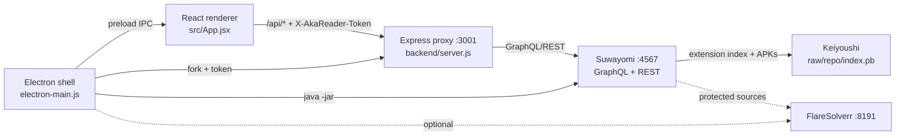

# akaReader Map

Hub note for opening `docs/` as an Obsidian vault. Start here, then follow links. The detailed notes are [[ARCHITECTURE]], [[FILE_MAP]], [[KNOWN_BUGS]], [[DEV_WORKFLOW]] and [[PUBLISHING]]. Agent rules live in the repo root `AGENTS.md`.

## The three processes

| Part | Main file | Size | Role |
|---|---|---|---|
| Shell | `manga-nexus/electron-main.js` | ~2.5k lines | Java/JRE, Suwayomi JAR + `server.conf`, backend fork, tray, updates, CBZ export, verification view, Discord |
| Bridge | `manga-nexus/preload.js` | ~90 | API token + IPC to renderer |
| Proxy | `backend/server.js` | ~710 | Normalizes Suwayomi, caches, image proxy |
| UI | `manga-nexus/src/App.jsx` | ~7k | State machine, `DataProvider`, IndexedDB downloads, navigation |
| Reader | `src/components/reader/Reader.jsx` | ~1.3k | Reading session, page persistence, preload |

## Backend routes (`backend/server.js`)

- `GET /api/ping`, `/api/health`, `/api/img` (Suwayomi-origin image proxy only)
- `GET /api/extensions` (`?force=1`) → see [[#Extension pipeline]]
- `POST /api/extensions/{install,uninstall,update}/:pkgName`
- `GET /api/sources`
- `GET /api/source/:sourceId/search`
- `GET /api/source/:sourceId/manga/:mangaId` (`?force=1` bypasses 10-min cache)
- `GET /api/source/:sourceId/chapter/:chapterId` (+ `/download`)

## Runtime helpers (`manga-nexus/runtime/*.cjs`)

`backend-runtime` (packaged backend preflight) · `java-runtime` (Java 21.0.11+, managed JRE) · `extension-stores` (built-in/custom stores → `server.conf`) · `cloudflare-helper` (FlareSolverr install/start) · `source-verification` (embedded verify view) · `window-lifecycle` · `chapter-export` (CBZ) · `discord-presence`

## Renderer utils (`manga-nexus/src/utils/`)

`readerProgress` · `chapterTracking` · `chapterUpdates` · `downloadQueue` · `downloadStorage` · `browsePagination` · `libraryFilters` · `appBackup` · `sourceErrors` · `readerZoom` · `helpers`. Each one has a matching test in `manga-nexus/test/`.

## Extension pipeline

1. Electron writes `server.extensionStores` in Suwayomi's `server.conf` before launch, using the built-in `https://github.com/keiyoushi/extensions/raw/repo/index.pb` plus validated custom stores (`runtime/extension-stores.cjs`).
2. Suwayomi fetches the index and **persists it in its DB**. Installs download APKs from those stored rows.
3. The backend runs `fetchExtensions` once per launch before the first `/api/extensions` listing.
4. Install and update call `updateExtension(patch:{install|update:true})`. On failure they refresh the index and retry once.

> [!warning] Gotcha (fixed 2026-10-18)
> Keiyoushi's `index.min.json` is now an "outdated app" stub. The real catalog is gzipped protobuf at `index.pb`, with APKs under GitHub release assets. Stale DB rows caused install 404s. See [[KNOWN_BUGS#Fixed 2026-10-18 Extension installs failed with HTTP 404 after Keiyoushi's index change]].

## Commands (from `manga-nexus/`)

- `npm test`: node test runner over `test/*.test.mjs`
- `npm run check:hook-order`: run it after moving callbacks in App/Reader
- `npx vite build`: renderer build check
- More in [[DEV_WORKFLOW]] and [[PUBLISHING]]

## App.jsx landmarks

`App.jsx` is about 7k lines. Don't read it top to bottom. Grep for a banner (`// ==================== NAME`) or a component name, then read only that range. Line numbers drift, so search by name.

| Banner → component | What it holds |
|---|---|
| `CONFIG & CONSTANTS` | `CONFIG`, `UPDATE_INTERVAL_OPTIONS`, `THEMES` (reader backgrounds), `proxyImg`, `IS_ANDROID_APP` |
| `CONTEXT` → `DataProvider` | All persisted state (library, history, progress, settings, categories, download queue) and its actions. The `useData()` value is built at the end. |
| `UI PRIMITIVES` | `Spin`, `Btn` (takes `type`), `Badge`, `EmptyState`, `ContextMenu` |
| `SETTINGS PAGE` | `SETTINGS_SECTIONS` holds each section's rail id, icon, lede and search keywords. Next come `SetGroup`, `SetRow`, `SetSegs`, `SetStatus`, `CategoryAddRow` and `ReaderPreview`, then `SettingsPage`. Each section renders from a `current.id === '…'` block in its return. Styles are the `.set-*` block at the end of `index.css`. The active section is saved as `settingsSection`. |
| `UPDATES TAB` / `DOWNLOADS TAB` | `UpdatesTab`, `DownloadsTab` |
| `DOWNLOADED CHAPTERS (IndexedDB)` | Offline blob helpers, then `Onboarding` |
| `STARTUP SCREEN`, `ERROR RECOVERY MODAL` | Service startup UI |
| `DISCOVER TAB`, `SOURCE MIGRATION`, `CATCH-UP MODE` | Feature screens and modals |
| `MAIN APP` | (banner only). The Library tab renders inside `App` under `{tab === 'library'` as `.lib-bar` (category tabs + search/sort/select/view), `.lib-chips` (smart views), then the grid. The header subtitle is `librarySummary`. Styles are the `.lib-*` block in `index.css`. |
| `App` → `NAV` / `nowReading` | Sidebar. `NAV` items carry a `group` (Read/Find/App), `badge` (action counts only), `meta` (muted text) and `live` (active downloads). The JSX is `<aside>` → `.side-nav`, then `.side-now` (resume card, hidden on Home), then `.side-foot` (streak + collapse). Styles are the `.side-*` block in `index.css`. Nav buttons keep `data-onboard="nav-<id>"` for the tutorial. |
| `views/HomeView.jsx` | Home: `.home-top` (the `.home-cont` Continue card + the `.home-upnext` list of 3 other in-progress titles), then New chapters (from `updates`), then the Recently added `HeroRow`. `chapterLabel()` hides an unknown chapter (`'0'`/empty). Styles are the `.home-*` block in `index.css`. |
| `APP & ROOT COMPONENT` → `App` | Navigation state and handlers, in this order: the reader branch (`<NewReader phone={IS_ANDROID_APP}>`), the Android branch (`<MobileApp app={…}>`), then the desktop shell. Tabs render as `{tab === 'name' && …}`. |

Dark-theme contrast comes from the `:root` tokens in `index.css` (`--text-dim`, `--muted`, `--border`, `--card`). Raise those before overriding colours inline.

## Phone UI and Android

- `src/mobile/MobileApp.jsx` is the phone shell: floating pill nav; Library, Updates, Browse, History and More screens; the manga page; and sheets. It gets every handler from `App` through one `app` prop. Android Back arrives as an Escape keydown.
- `src/mobile/MobileSettings.jsx` is the phone Settings page. It writes the same setting keys as `SettingsPage`, minus the desktop-only ones.
- `src/mobile/mobile.css`: every class starts with `m-`.
- `Reader.jsx`'s `phone` prop adds a bottom control bar (page scrubber plus Scroll/Paged/Strip/Auto/Settings) and turns the settings panel into a bottom sheet. On phone, `uiAccent` is fixed orange so active states stay visible on white pages.
- `android/`: see [[ARCHITECTURE#Android app (proof of concept)]] and [[DEV_WORKFLOW#Android App (proof of concept)]].

## Before you edit

- Reader changes: read both `App.jsx` and `Reader.jsx`.
- Startup changes: read `electron-main.js`, `preload.js` and `server.js`.
- Offline chapters load from IndexedDB before the network.
- Major changes must update AGENTS.md and the four docs above.
